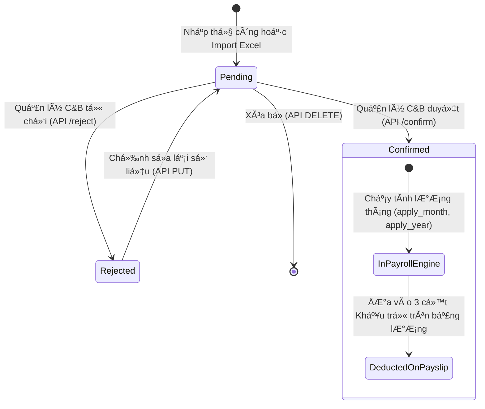

# TÀI LIỆU ĐẶC TẢ NGHIỆP VỤ & API — QUẢN LÝ ĐIỀU CHỈNH BẢO HIỂM XÃ HỘI (INSURANCE ADJUSTMENTS)
**Hệ Thống:** Green Speed HRIS — Phân Hệ Web Payroll & Quản Lý Bảo Hiểm  
**Phiên bản:** 1.0.0  
**Ngày cập nhật:** 21/10/2026  
**Module:** `WebPayroll - Insurance Adjustments`  

---

## 1. TỔNG QUAN & NGUYÊN TẮC NGHIỆP VỤ

### 1.1. Mục đích
Trong quá trình quản lý hồ sơ trích nộp bảo hiểm xã hội (BHXH) hàng tháng của người lao động (NLĐ), ngoài việc đóng BHXH định kỳ theo kỳ tính lương, bộ phận C&B thường xuyên phát sinh các nghiệp vụ điều chỉnh đặc thù:
1. **Điều chỉnh kỳ trước trừ chi phí NLĐ (`PREV_PERIOD_ADJ`)**:
   - Truy thu hoặc thoái thu tiền đóng BHXH phát sinh từ các tháng trước (ví dụ: tháng trước báo tăng muộn, điều chỉnh hồi tố mức đóng BHXH, hoặc cơ quan BHXH trả về kết quả truy thu/thoái thu).
   - **Đặc điểm số tiền**: Có thể mang **giá trị dương (+)** (truy thu thêm tiền từ NLĐ) hoặc **giá trị âm (-)** (thoái thu/hoàn tiền lại cho NLĐ).
   - **Thông tin kỳ gốc**: Có trường Năm kỳ gốc (`ref_year`) và Tháng kỳ gốc (`ref_month`) để truy vết nghiệp vụ phát sinh từ kỳ nào trong quá khứ.
2. **Trừ thẻ BHYT (`HI_CARD_DEDUCTION`)**:
   - Khấu trừ tiền thẻ bảo hiểm y tế của NLĐ (ví dụ: trường hợp NLĐ nghỉ việc không trả lại thẻ BHYT hoặc phát sinh chi phí thẻ BHYT cần trừ vào lương).
   - **Đặc điểm số tiền**: Luôn là **số tiền dương (> 0)**, khấu trừ trực tiếp vào thu nhập của NLĐ.
3. **Thối thu lại tiền thẻ BHYT cho NLĐ (`HI_CARD_REFUND`)**:
   - Hoàn trả lại tiền thẻ BHYT đã trừ trước đó khi NLĐ bàn giao lại thẻ hợp lệ theo quy định.
   - **Đặc điểm số tiền**: Nhập vào là **số tiền dương (> 0)**; khi tính lương sẽ tự động đảo dấu âm để **làm giảm tổng số tiền bị khấu trừ** (tương đương trả tiền lại cho NLĐ).

---

### 1.2. Các Quyết Định Nghiệp Vụ Cốt Lõi (Architecture Decisions)
- **Cơ chế lưu trữ độc lập**: Quản lý tại bảng riêng `insurance.insurance_adjustment` (không gộp chung cột vào `insurance.employee_insurance_period`) để quản lý đa bản ghi, lưu kèm số quyết định, biên bản và tài liệu đính kèm.
- **Không phân loại theo cấu phần bảo hiểm**: Tính chung **một cục tiền điều chỉnh tổng hợp** (không tách riêng tỷ lệ 8% BHXH, 1.5% BHYT, 1% BHTN).
- **Import đồng thời 1 file Excel (2 Sheet)**:
  - File Excel duy nhất hỗ trợ 2 nghiệp vụ cùng lúc:
    - **Sheet 1 (`DongBHXH`)**: Danh sách đóng BHXH định kỳ hàng tháng.
    - **Sheet 2 (`DieuChinhBH`)**: Danh sách điều chỉnh bảo hiểm (kỳ trước, trừ thẻ, thối thẻ).
    - **Sheet 3 (`DanhMuc`)**: Sheet ẩn dùng cho danh mục cấu hình Data Validation (Dropdown tiếng Việt).
  - Cả 2 sheet được thực thi trong **cùng một Database Transaction**: nếu có lỗi ở bất kỳ dòng nào của bất kỳ sheet nào thì rollback toàn bộ để bảo toàn dữ liệu.
- **Giao diện tiếng Việt — Mã hệ thống chuẩn**:
  - Trên Excel template: Dropdown hiển thị hoàn toàn bằng **tiếng Việt**.
  - Backend tự động chuẩn hóa và map về mã code chuẩn của hệ thống (`PREV_PERIOD_ADJ`, `HI_CARD_DEDUCTION`, `HI_CARD_REFUND`).

---

### 1.3. Cơ Chế Tính Lương & Tích Hợp Payroll Engine

#### Vị trí trên Bảng Lương (Payroll Sheet):
- Cả 3 khoản điều chỉnh này được hiển thị thành **3 cột lương riêng biệt** trên bảng lương.
- Thuộc nhóm **Khấu trừ (Deductions)** (`category_code = 'deduction'`, `sign = -1`).
- **Tuyệt đối không đưa vào Gross**: Tránh làm sai lệch thu nhập chịu thuế và tiền lương căn bản.
- **Không làm sai lệch giảm trừ BHXH khi tính Thuế TNCN**: Khoản BHXH được trừ trước khi tính thuế TNCN (`InsuranceEmployee`) chỉ căn cứ vào mức đóng BHXH định kỳ của tháng (`TOTAL_INSURANCE_EMP`), không bị ghi đè bởi các khoản điều chỉnh kỳ trước.

#### Cấu hình Công thức lương:
| Thành phần lương | Mã biến (Variable) | Loại (Sign) | Công thức mẫu | Ý nghĩa nghiệp vụ |
|---|---|:---:|---|---|
| **Điều chỉnh BHXH kỳ trước** | `{INSURANCE_PREV_ADJUSTMENT}` | `-1` (Deduction) | `{INSURANCE_PREV_ADJUSTMENT}` | Tiền dương (+) trừ thêm tiền của NLĐ; Tiền âm (-) giảm khấu trừ (hoàn tiền) |
| **Trừ tiền thẻ BHYT** | `{HI_CARD_DEDUCTION}` | `-1` (Deduction) | `{HI_CARD_DEDUCTION}` | Tăng tiền khấu trừ của NLĐ |
| **Thối thu tiền thẻ BHYT** | `{HI_CARD_REFUND}` | `-1` (Deduction) | `0 - {HI_CARD_REFUND}` | Mang giá trị âm trên cột khấu trừ, giúp giảm tổng tiền khấu trừ của NLĐ |

#### Nguyên tắc áp dụng theo Kỳ lương:
- **Kỳ lương Tháng chính thức / Quyết toán (`monthly` / `is_settlement = 1`)**: Tự động tổng hợp và nạp tất cả các bản ghi có trạng thái **Đã duyệt (`status = 'confirmed'`)** trong tháng áp dụng.
- **Kỳ lương Tạm ứng / Tuần (`advance` / `weekly`)**: **Bỏ qua**, không khấu trừ các khoản điều chỉnh bảo hiểm này ở kỳ tuần/tạm ứng.

---

## 2. CƠ SỞ DỮ LIỆU & MASTER DATA

### 2.1. Bảng `insurance.insurance_adjustment`
Bảng lưu trữ thông tin điều chỉnh bảo hiểm:

```sql
CREATE TABLE insurance.insurance_adjustment (
    [id]                      int IDENTITY(1,1) NOT NULL,
    [employee_code]           varchar(50)       NOT NULL,    -- Mã nhân viên (GID)
    [adjustment_type]         varchar(30)       NOT NULL,    -- 'PREV_PERIOD_ADJ' | 'HI_CARD_DEDUCTION' | 'HI_CARD_REFUND'
    [project_id]              int               NULL,        -- Dự án áp dụng
    [apply_year]              int               NOT NULL,    -- Năm tính lương áp dụng
    [apply_month]             int               NOT NULL,    -- Tháng tính lương áp dụng (1-12)
    [ref_year]                int               NULL,        -- Năm kỳ gốc trước đó (chỉ áp dụng cho PREV_PERIOD_ADJ)
    [ref_month]               int               NULL,        -- Tháng kỳ gốc trước đó (chỉ áp dụng cho PREV_PERIOD_ADJ)
    [amount]                  decimal(18,2)     NOT NULL,    -- Số tiền điều chỉnh
    [status]                  varchar(20)       NOT NULL DEFAULT 'pending', -- 'pending' | 'confirmed' | 'rejected'
    [note]                    nvarchar(500)     NULL,        -- Ghi chú / lý do
    [status_note]             nvarchar(500)     NULL,        -- Lý do duyệt / từ chối
    [decision_number]         nvarchar(100)     NULL,        -- Số quyết định / biên bản
    [decision_date]           date              NULL,        -- Ngày ban hành quyết định
    [import_batch_id]         int               NULL,        -- Mã lô import (nếu import từ Excel)
    [created_at]              datetime2(3)      NOT NULL DEFAULT SYSDATETIME(),
    [created_by]              int               NULL,
    [updated_at]              datetime2(3)      NULL,
    [updated_by]              int               NULL,

    CONSTRAINT PK_insurance_adjustment PRIMARY KEY (id),
    CONSTRAINT CK_ins_adj_type CHECK (adjustment_type IN ('PREV_PERIOD_ADJ', 'HI_CARD_DEDUCTION', 'HI_CARD_REFUND'))
);
```

### 2.2. Bảng `insurance.insurance_adjustment_document`
Lưu trữ hồ sơ, tài liệu, quyết định, biên bản đính kèm minh chứng cho điều chỉnh:

```sql
CREATE TABLE insurance.insurance_adjustment_document (
    [id]                      int IDENTITY(1,1) NOT NULL,
    [insurance_adjustment_id] int               NOT NULL,
    [document_type]           varchar(50)       NULL,        -- 'DECISION', 'MINUTES', 'REPORT', 'OTHER'
    [file_name]               nvarchar(255)     NOT NULL,
    [file_path]               nvarchar(1000)    NOT NULL,
    [file_size]               bigint            NULL,
    [mime_type]               varchar(100)      NULL,
    [created_at]              datetime2(3)      NOT NULL DEFAULT SYSDATETIME(),
    [created_by]              int               NULL,

    CONSTRAINT PK_insurance_adjustment_document PRIMARY KEY (id),
    CONSTRAINT FK_ins_adj_doc_adj FOREIGN KEY (insurance_adjustment_id) 
        REFERENCES insurance.insurance_adjustment (id) ON DELETE CASCADE
);
```

### 2.3. Dữ liệu Master Cấu hình Lương
Đã được đồng bộ trong migration [Migration_Insurance_Adjustment_Tables.sql](file:///d:/Work/Work/Source/Internal/Timetracking/api-hris/HrisApi/script/Migration/Migration_Insurance_Adjustment_Tables.sql):
- **Cá»™t lÆ°Æ¡ng (`master.salary_component`)**:
  - `INSURANCE_PREV_ADJUSTMENT` — Điều chỉnh BHXH kỳ trước (NLĐ) (`category_id = 2`, `display_order = 47`)
  - `HI_CARD_DEDUCTION` — Trừ tiền thẻ BHYT (`category_id = 2`, `display_order = 48`)
  - `HI_CARD_REFUND` — Thối thu tiền thẻ BHYT (`category_id = 2`, `display_order = 49`)
- **Biến lương (`master.variable_definition`)**:
  - `{INSURANCE_PREV_ADJUSTMENT}` (`variable_group_id = 6`, `source_type = 'insurance_adjustment'`)
  - `{HI_CARD_DEDUCTION}` (`variable_group_id = 6`, `source_type = 'insurance_adjustment'`)
  - `{HI_CARD_REFUND}` (`variable_group_id = 6`, `source_type = 'insurance_adjustment'`)
- **Mẫu công thức (`master.formula_definition`)**:
  - `TPL_INSURANCE_PREV_ADJ` = `{INSURANCE_PREV_ADJUSTMENT}`
  - `TPL_HI_CARD_DEDUCTION` = `{HI_CARD_DEDUCTION}`
  - `TPL_HI_CARD_REFUND` = `0 - {HI_CARD_REFUND}`

---

## 3. QUY CÁCH FILE EXCEL TEMPLATE & IMPORT

### 3.1. Cấu trúc Template (`GET /api/v1/webpayroll/insurance/import-template`)
File Excel trả về gồm 3 Sheet:

#### Sheet 1: `DongBHXH` (Đóng BHXH định kỳ)
| Cột | Tiêu đề cột | Bắt buộc | Kiểu dữ liệu | Mô tả & Ràng buộc |
|:---:|---|:---:|---|---|
| A | Mã nhân viên | Có | Text | GID nhân viên trong hệ thống |
| B | Tên nhân viên | Không | Text | Tên hiển thị (để đối chiếu) |
| C | Mã số bảo hiểm xã hội | Không | Text | Tối đa 20 ký tự |
| D | **Loại biến động** | Có | Dropdown | Chọn từ danh mục tiếng Việt: `Đang tham gia`, `Tăng mới`, `Điều chỉnh mức đóng`, `Nghỉ thai sản`, `Nghỉ không lương`, `Báo giảm` |
| E | Mức đóng bảo hiểm | Có | Số | Tiền lương làm căn cứ trích đóng BHXH (>= 0) |
| F | Tháng | Có | Số | Tháng áp dụng (1 - 12) |
| G | Năm | Có | Số | Năm áp dụng (2000 - 2100) |
| H | Lý do | Không | Text | Tối đa 500 ký tự |
| I | Đủ điều kiện đóng bảo hiểm | Không | Checkbox | Đánh dấu tham gia (`true`/`false`) |

#### Sheet 2: `DieuChinhBH` (Điều chỉnh bảo hiểm)
| Cột | Tiêu đề cột | Bắt buộc | Kiểu dữ liệu | Mô tả & Ràng buộc |
|:---:|---|:---:|---|---|
| A | Mã nhân viên | Có | Text | GID nhân viên trong hệ thống |
| B | Tên nhân viên | Không | Text | Tên hiển thị (để đối chiếu) |
| C | **Loại điều chỉnh** | Có | Dropdown | Chọn từ danh mục tiếng Việt:<br>• `Điều chỉnh kỳ trước trừ chi phí NLĐ`<br>• `Trừ thẻ BHYT`<br>• `Thối thu lại tiền thẻ cho NLĐ` |
| D | Tháng áp dụng | Có | Số | Tháng tính lương áp dụng (1 - 12) |
| E | Năm áp dụng | Có | Số | Năm tính lương áp dụng (2000 - 2100) |
| F | Tháng kỳ gốc | Chỉ khi là `PREV_PERIOD_ADJ` | Số | Tháng phát sinh kỳ trước (1 - 12) |
| G | Năm kỳ gốc | Chỉ khi là `PREV_PERIOD_ADJ` | Số | Năm phát sinh kỳ trước (2000 - 2100) |
| H | Số tiền (VNĐ) | Có | Số | • Với `PREV_PERIOD_ADJ`: có thể là số âm hoặc dương (!= 0)<br>• Với `HI_CARD_DEDUCTION` & `HI_CARD_REFUND`: phải là số dương (> 0) |
| I | Số quyết định / Biên bản | Không | Text | Tối đa 100 ký tự |
| J | Ghi chú | Không | Text | Tối đa 500 ký tự |

#### Sheet 3: `DanhMuc` (Sheet ẩn)
- Cột A: Danh mục loại biến động đóng BHXH định kỳ.
- Cột B: Danh mục loại điều chỉnh bảo hiểm.

---

### 3.2. Bảng ánh xạ tiếng Việt sang Mã Code hệ thống

#### Ánh xạ Loại biến động (Sheet `DongBHXH`):
| Hiển thị tiếng Việt trên Dropdown | Mã Code lưu Database | Ý nghĩa |
|---|---|---|
| `Đang tham gia` | `ACTIVE` | Nhân viên đang tiếp tục tham gia đóng BHXH |
| `Tăng mới` | `NEW_HIRE` | Nhân viên mới bắt đầu tham gia đóng BHXH |
| `Điều chỉnh mức đóng` | `SALARY_ADJUSTMENT` | Điều chỉnh tăng/giảm mức lương căn cứ đóng BHXH |
| `Nghỉ thai sản` | `MATERNITY` | Nhân viên nghỉ hưởng chế độ thai sản |
| `Nghỉ không lương` | `UNPAID_LEAVE` | Nhân viên nghỉ không hưởng lương từ 14 ngày/tháng trở lên |
| `Báo giảm` | `TERMINATED` | Báo giảm hẳn / thôi việc |

*(Hệ thống hỗ trợ tự động nhận diện cả tiếng Việt có dấu, không dấu, và mã tiếng Anh cũ).*

#### Ánh xạ Loại điều chỉnh (Sheet `DieuChinhBH`):
| Hiển thị tiếng Việt trên Dropdown | Mã Code lưu Database | Ràng buộc số tiền |
|---|---|---|
| `Điều chỉnh kỳ trước trừ chi phí NLĐ` | `PREV_PERIOD_ADJ` | Khác 0 (cho phép âm hoặc dương), bắt buộc có `ref_month`, `ref_year` |
| `Trừ thẻ BHYT` | `HI_CARD_DEDUCTION` | Lớn hơn 0 (> 0) |
| `Thối thu lại tiền thẻ cho NLĐ` | `HI_CARD_REFUND` | Lớn hơn 0 (> 0) |

---

## 4. DANH SÁCH CHI TIẾT CÁC API ENDPOINTS

Base URL: `/api/v1/webpayroll`  
Yêu cầu Header: `Authorization: Bearer <token>`  
Content-Type: `application/json` (hoặc `multipart/form-data` với file upload)

| STT | Phương thức | Đường dẫn (Route) | Mô tả chức năng |
|:---:|:---:|---|---|
| **1** | `GET` | `/insurance/import-template` | Tải file Excel template mẫu (gồm 2 sheet có sẵn validation dropdown) |
| **2** | `POST` | `/insurance/import-periods` | Import file Excel chứa cả 2 sheet (Đóng BHXH & Điều chỉnh BHXH) |
| **3** | `GET` | `/insurance/adjustments` | Tìm kiếm, phân trang danh sách các khoản điều chỉnh bảo hiểm |
| **4** | `GET` | `/insurance/adjustments/{id}` | Lấy chi tiết 1 khoản điều chỉnh và danh sách tài liệu đính kèm |
| **5** | `POST` | `/insurance/adjustments` | Thêm mới thủ công 1 khoản điều chỉnh bảo hiểm |
| **6** | `PUT` | `/insurance/adjustments/{id}` | Cập nhật thông tin khoản điều chỉnh (chỉ khi đang ở trạng thái `pending`) |
| **7** | `DELETE`| `/insurance/adjustments/{id}` | Xóa khoản điều chỉnh (chỉ khi đang ở trạng thái `pending`) |
| **8** | `POST` | `/insurance/adjustments/{id}/confirm` | Duyệt khoản điều chỉnh (`confirmed`) để nạp vào bảng lương |
| **9** | `POST` | `/insurance/adjustments/{id}/reject` | Từ chối khoản điều chỉnh (`rejected`) kèm lý do |
| **10**| `POST` | `/insurance/adjustments/{id}/documents`| Upload quyết định/biên bản đính kèm cho khoản điều chỉnh |
| **11**| `DELETE`| `/insurance/adjustments/documents/{documentId}` | Xóa tài liệu đính kèm |

---

### 4.1. GET /insurance/import-template
Tải file Excel mẫu gồm 2 sheet `DongBHXH` và `DieuChinhBH`.

- **Response**: Trả về binary stream file Excel `.xlsx` (`Insurance_Import_Template.xlsx`).

---

### 4.2. POST /insurance/import-periods
Import đồng thời cả dữ liệu đóng BHXH định kỳ và dữ liệu điều chỉnh bảo hiểm từ file Excel.

- **Content-Type**: `multipart/form-data`
- **Request Parameters**:
  - `file`: File Excel (.xlsx / .xls)
  - `projectId`: ID dự án (int, bắt buộc)
- **Response Success (200 OK)**:
```json
{
  "success": true,
  "data": {
    "totalRows": 25,
    "successRows": 25,
    "errorRows": 0,
    "batchCode": "IPS_20261021153000123",
    "errors": []
  },
  "message": "Import thành công 25 dòng dữ liệu bảo hiểm."
}
```
- **Response Failed / Validation Error (400 Bad Request)**:
```json
{
  "success": false,
  "message": "Dữ liệu import có lỗi. Vui lòng kiểm tra danh sách lỗi chi tiết.",
  "data": {
    "totalRows": 20,
    "successRows": 0,
    "errorRows": 2,
    "errors": [
      {
        "row": 3,
        "column": "Điều chỉnh - Cột F",
        "value": "",
        "message": "[Điều chỉnh BH] Khoản điều chỉnh kỳ trước bắt buộc phải nhập tháng kỳ gốc.",
        "errorCode": "REQUIRED_REF_MONTH"
      }
    ]
  }
}
```

---

### 4.3. GET /insurance/adjustments
Tra cứu danh sách điều chỉnh bảo hiểm phục vụ màn hình quản trị C&B.

- **Query Parameters**:
  - `projectId` (`int`, optional): Lọc theo ID dự án
  - `year` (`int`, optional): Năm áp dụng
  - `month` (`int`, optional): Tháng áp dụng
  - `adjustmentType` (`string`, optional): `PREV_PERIOD_ADJ` | `HI_CARD_DEDUCTION` | `HI_CARD_REFUND`
  - `status` (`string`, optional): `pending` | `confirmed` | `rejected`
  - `keyword` (`string`, optional): Tìm theo Mã nhân viên (GID) hoặc Họ tên
  - `pageIndex` (`int`, default: 1): Trang hiện tại
  - `pageSize` (`int`, default: 20): Kích thước trang
- **Response Success (200 OK)**:
```json
{
  "success": true,
  "data": {
    "items": [
      {
        "id": 105,
        "employeeCode": "EMP00123",
        "employeeName": "Trần Thị Mai",
        "adjustmentType": "PREV_PERIOD_ADJ",
        "adjustmentTypeName": "Điều chỉnh kỳ trước trừ chi phí NLĐ",
        "projectId": 12,
        "projectName": "Dự án Kho Vận Long An",
        "applyYear": 2026,
        "applyMonth": 10,
        "refYear": 2026,
        "refMonth": 8,
        "amount": 250000.0,
        "status": "confirmed",
        "statusName": "Đã duyệt",
        "decisionNumber": "QĐ-124/2026/HR",
        "decisionDate": "2026-10-15",
        "note": "Truy thu tiền BHXH do báo tăng muộn kỳ tháng 8",
        "statusNote": "Hồ sơ đối chiếu BHXH hợp lệ",
        "documentCount": 1,
        "createdAt": "2026-10-21T08:30:00"
      }
    ],
    "totalCount": 1,
    "pageIndex": 1,
    "pageSize": 20
  }
}
```

---

### 4.4. POST /insurance/adjustments
Thêm mới thủ công một khoản điều chỉnh bảo hiểm.

- **Request Body**:
```json
{
  "employeeCode": "EMP00123",
  "adjustmentType": "PREV_PERIOD_ADJ",
  "projectId": 12,
  "applyYear": 2026,
  "applyMonth": 10,
  "refYear": 2026,
  "refMonth": 8,
  "amount": 250000,
  "note": "Truy thu tiền BHXH tháng 8",
  "decisionNumber": "QĐ-124/2026/HR",
  "decisionDate": "2026-10-15"
}
```
- **Ràng buộc kiểm tra**:
  - `employeeCode` phải tồn tại trong hệ thống.
  - `applyMonth` (1-12), `applyYear` (2000-2100).
  - Với `PREV_PERIOD_ADJ`: Bắt buộc phải có `refYear` và `refMonth`. `amount` != 0.
  - Với `HI_CARD_DEDUCTION` và `HI_CARD_REFUND`: `amount` > 0.
- **Response Success (200 OK)**:
```json
{
  "success": true,
  "data": 105,
  "message": "Tạo khoản điều chỉnh bảo hiểm thành công."
}
```

---

### 4.5. PUT /insurance/adjustments/{id}
Chỉnh sửa thông tin điều chỉnh bảo hiểm.

- **Điều kiện**: Chỉ được phép chỉnh sửa khi bản ghi đang ở trạng thái `pending`.
- **Request Body**: Tương tự như API tạo mới.

---

### 4.6. DELETE /insurance/adjustments/{id}
Xóa khoản điều chỉnh bảo hiểm.

- **Điều kiện**: Chỉ được phép xóa khi bản ghi đang ở trạng thái `pending`.

---

### 4.7. POST /insurance/adjustments/{id}/confirm
Phê duyệt khoản điều chỉnh bảo hiểm.

- **Mục đích**: Chuyển trạng thái sang `confirmed`. Chỉ những khoản ở trạng thái `confirmed` mới được Engine tự động nạp vào Bảng lương của tháng.
- **Request Body**:
```json
{
  "note": "Đã đối chiếu khớp số liệu với cơ quan BHXH"
}
```

---

### 4.8. POST /insurance/adjustments/{id}/reject
Từ chối khoản điều chỉnh bảo hiểm.

- **Mục đích**: Chuyển trạng thái sang `rejected`, không áp dụng vào tính lương.
- **Request Body**:
```json
{
  "note": "Sai thông tin số tiền, yêu cầu kiểm tra lại hồ sơ gốc"
}
```

---

### 4.9. POST /insurance/adjustments/{id}/documents
Upload quyết định / biên bản / hóa đơn chứng từ đính kèm cho khoản điều chỉnh.

- **Content-Type**: `multipart/form-data`
- **Request Parameters**:
  - `file`: File tài liệu (PDF, Word, Excel, Hình ảnh)
  - `documentType`: Mã loại tài liệu (`DECISION`, `MINUTES`, `REPORT`, ...)
- **Response Success (200 OK)**:
```json
{
  "success": true,
  "data": 12,
  "message": "Tải lên tài liệu thành công."
}
```

---

## 5. FLOW DIỄN BIẾN TRẠNG THÁI (LIFECYCLE & STATE MACHINE)



---

## 6. KIỂM THỬ & SÁCH HƯỚNG DẪN C&B (TEST CASES & FAQ)

### 6.1. Trường hợp kiểm thử tiêu biểu

| STT | Kịch bản kiểm thử | Dữ liệu đầu vào | Kỳ vọng hệ thống |
|:---:|---|---|---|
| 1 | Import file Excel hợp lệ cả 2 sheet | Sheet 1: 5 dòng, Sheet 2: 3 dòng | Tạo thành công 5 kỳ đóng BHXH và 3 khoản điều chỉnh ở trạng thái `pending`. |
| 2 | Import lỗi ở Sheet 2 (thiếu tháng kỳ gốc) | Sheet 1: đúng hết, Sheet 2: dòng 2 thiếu `ref_month` | **Rollback toàn bộ**. Không lưu dòng nào của cả Sheet 1 và Sheet 2. Trả về thông báo lỗi chi tiết dòng 2 Sheet 2. |
| 3 | Điều chỉnh kỳ trước là tiền âm (-) | `PREV_PERIOD_ADJ` = -250.000đ | Chấp nhận import. Khi tính lương, `{INSURANCE_PREV_ADJUSTMENT}` = -250.000đ -> Giảm tiền khấu trừ của NLĐ. |
| 4 | Trừ thẻ BHYT nhập tiền âm | `HI_CARD_DEDUCTION` = -150.000đ | Báo lỗi: "Số tiền trừ thẻ BHYT phải lớn hơn 0". |
| 5 | Thối thu lại tiền thẻ BHYT | `HI_CARD_REFUND` = 150.000đ | Chấp nhận. Khi tính lương, công thức `0 - {HI_CARD_REFUND}` = -150.000đ -> Làm giảm tổng khấu trừ của NLĐ đúng 150.000đ. |
| 6 | Bảng lương Tạm ứng / Tuần | Bảng lương loại `advance` / `weekly` | Tự động bỏ qua cả 3 khoản điều chỉnh bảo hiểm, không trừ tiền ở kỳ tuần. |
| 7 | Bảng lương Tháng chính thức | Bảng lương loại `monthly` (tháng 10/2026) | Chỉ lấy các bản ghi có `status = 'confirmed'`. Bản ghi `pending` hoặc `rejected` không được trừ vào lương. |

